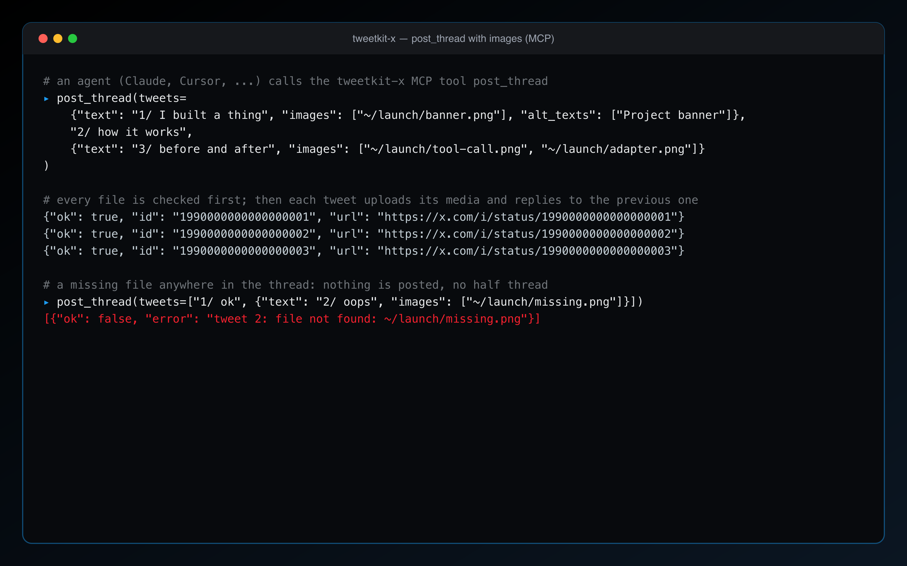

<!-- mcp-name: io.github.nsozturk/tweetkit-x -->

<p align="center">
  
</p>

<h1 align="center">tweetkit-x</h1>

<p align="center">
  <b>tweetkit-x is a free, open-source Python library, CLI and MCP server that posts, deletes and reads on X (Twitter) with your own logged-in web session, including images and threads, with no paid API.</b><br>
  No paid API. No developer app. No OAuth dance. Just your session cookie.
</p>

<p align="center">
  <a href="https://github.com/nsozturk/tweetkit-x/releases/tag/v0.5.0"></a>
  <a href="https://github.com/nsozturk/tweetkit-x/releases"></a>
  <a href="https://pypi.org/project/tweetkit-x/"></a>
  
  
  
  
  <a href="AGENTS.md"></a>
  
  
</p>

<p align="center">
  <code>twitter</code> <code>x</code> <code>mcp-server</code> <code>python</code> <code>cli</code> <code>twitter-api-alternative</code> <code>no-api-key</code> <code>threads</code> <code>image-upload</code> <code>claude</code> <code>cursor</code>
</p>

<p align="center">
  📘 <a href="https://nsozturk.github.io/tweetkit-x/">Docs site</a> ·
  🤖 <a href="AGENTS.md">AGENTS.md</a> (for coding agents) ·
  📦 <a href="https://github.com/nsozturk/tweetkit-x/releases">Releases</a>
</p>

<p align="center">
  <a href="#quick-start">Quick start</a> ·
  <a href="#screenshots">Screenshots</a> ·
  <a href="#getting-your-session-cookie">Get your cookie</a> ·
  <a href="#python-usage">Python</a> ·
  <a href="#cli-usage">CLI</a> ·
  <a href="#mcp-server">MCP server</a> ·
  <a href="#how-it-works">How it works</a> ·
  <a href="#faq">FAQ</a> ·
  <a href="#alternatives--compared-with">Alternatives</a> ·
  <a href="#changelog">Changelog</a> ·
  <a href="#disclaimer">Disclaimer</a>
</p>

---

## Screenshots

<p align="center">
  
</p>

The MCP tool `post_thread` posting a three-tweet thread with images, as shipped in 0.5.0. Generated by `python3 scripts/make_screenshots.py`: the tools run unchanged, but the X transport is an in-memory stand-in, so no request reaches X and the ids and URLs are made up.

---

## Why

Since **February 6, 2026**, X's official API has **no free tier for new developers** — it's pay-per-use: **~$0.015 per post, ~$0.20 per post with a link**, plus per-read charges. For publishing *your own* tweets (a bot posting your content, a scheduled thread, a cleanup script that deletes old posts), that's a recurring bill for something your browser already does for free.

**tweetkit-x** skips the API entirely. It replays the exact internal HTTP calls your browser makes when you click **Post**, **Delete**, or scroll your profile — authenticated with the session cookie you already have. Post, delete, and read the full timeline, at **zero API cost**.

> ⚠️ Automating your web session is **against X's Terms of Service**. This is a grey-area tool for personal automation. **Account risk is entirely yours.** See the [Disclaimer](#disclaimer).

---

## Features

- ✅ **Post** — text, **up to 4 images**, **GIF &amp; video** (with **alt text**), replies, **threads**, **quote-tweets**, **long-form note tweets**, and **scheduled** tweets
- 🖼️ **Images through MCP, in single tweets and in threads** — `post_tweet` takes up to 4 files with alt text, and every tweet of a `post_thread` can carry its own up to 4 files; the whole thread is checked before the first tweet is posted
- 🗑️ **Delete** — one id, a list of ids, or "find matching &amp; delete" cleanup loops
- ❤️ **Engage** — like, retweet, bookmark, **follow, block, mute, pin** — each with an undo
- 🔔 **Per-account bell &amp; bulk follow** — turn notifications on/off per account, follow a list resumably with a journal and rate-limit stops
- 🌐 **Search all of X** — the real `SearchTimeline` (operators like `from:`, `min_faves:`, `filter:media`), plus local regex over your own tweets
- 📖 **Read** — your **home feed**, any timeline, a tweet's **replies/conversation**, **followers/following**, **likers/retweeters**, **bookmarks**, a user's **likes**, **notifications**, and full **profiles**
- 🔌 **MCP server** — **48 tools**; drop into Claude Desktop / Claude Code / Cursor; tools that **explain the cookie** and set it up with one paste
- 🔑 **Frictionless auth** — paste a `Cookie:` header, drop a **HAR** file, or a **storage-dump zip**; store in a file or the macOS **Keychain**
- 🐍 **Python API** *and* a **CLI** (`tweetkit …`)
- 🪶 Tiny footprint — no headless browser, no Selenium

---

## Quick start

```bash
# v0.5.0 (48 MCP tools, images in MCP tweets and threads) — from the GitHub release tag:
pip install "tweetkit-x[mcp] @ git+https://github.com/nsozturk/tweetkit-x@v0.5.0"
#   or download the wheel from https://github.com/nsozturk/tweetkit-x/releases/tag/v0.5.0
#   PyPI (`pip install "tweetkit-x[mcp]"`) still serves 0.3.0, which lacks the 0.5.0 MCP features.

# 1. Import your session cookie (three ways — see the next section)
tweetkit import --paste                       # paste the Cookie: header, Ctrl-D
#   or:  tweetkit import --file x.com.har
#   or:  tweetkit --keychain tweetkit import --file storagedump_x.com.zip

# 2. Verify (no network call)
tweetkit whoami
# {"ready": true, "user_id": "1986...", "ct0_len": 160}

# 3. Use it
tweetkit post "hello world 👋"
tweetkit search "xmr|monero" --regex          # your tweets that match
tweetkit delete 2063240404980445603
```

`--keychain` and `--cookie-file` are global options: they go **before** the subcommand (`tweetkit --keychain tweetkit post "hi"`).

---

## Getting your session cookie

The **only** secret tweetkit needs is your X **session cookie** — the same `Cookie:` header your logged-in browser sends. It must contain **at least two** values:

| Cookie | What it is | Required | HttpOnly? |
|---|---|---|---|
| `auth_token` | your login/session token | **yes** | **yes** (hidden from `document.cookie`) |
| `ct0` | CSRF token (sent back as `x-csrf-token`) | **yes** | no |
| `twid` | your user id (`u=<id>`) — lets tweetkit read *your* timeline with no extra lookup | recommended | no |
| `guest_id`, `kdt`, `att`, `personalization_id` | misc session state | optional | mixed |

> ❗ `auth_token` is **HttpOnly**, so a `document.cookie` copy in the JS console will **NOT** include it. Use one of the reliable methods below.

### Method A — copy the `Cookie:` header (most reliable, one paste)

1. Open **x.com** while logged in.
2. Open **DevTools (F12)** → the **Network** tab.
3. Click any request to `x.com` (e.g. `HomeTimeline`).
4. Under **Request Headers**, find **`cookie:`** and copy the **entire** value.
5. Feed it in:

```bash
tweetkit import --paste
# paste the cookie header, then press Ctrl-D
```

### Method B — an F12 "Preserve log" HAR file

1. Open **x.com** logged in → **DevTools (F12)** → **Network**.
2. Tick **"Preserve log"**, then reload / click around so requests are captured.
3. **Right-click any request → "Save all as HAR"** (or use the ⬇ export icon).
4. Import it:

```bash
tweetkit import --file ~/Downloads/x.com.har
```

> Modern Chrome can **redact cookies** from exported HARs. If tweetkit reports `auth_token` missing, either enable **"Allow to generate HAR with sensitive data"** in the Network settings, or fall back to **Method A** / **Method C**.

### Method C — the **storagedump** browser extension (zip)

The easiest no-DevTools route. **[storagedump](https://chromewebstore.google.com/detail/storagedump/kihoghfekemdccfnpjefmggehpgnjnab)** (a Chrome extension built by this project's author) exports a tab's browser storage — including the **HttpOnly** `auth_token`, which `document.cookie` can't reach — as a `.zip` containing `cookies.json`. On x.com (logged in), click the extension → export, then:

```bash
tweetkit import --file storagedump_x.com_2026-07-05.zip
```

tweetkit reads the extension's native format, `{ "data": [ { "key": "...", "value": "..." }, ... ] }`, and also accepts a plain list or a `{name: value}` map. Cookie-Editor / EditThisCookie JSON exports (`--file export.json`) work too.

> Install: **[storagedump on the Chrome Web Store](https://chromewebstore.google.com/detail/storagedump/kihoghfekemdccfnpjefmggehpgnjnab)**.

### Where the cookie is stored

By default `tweetkit import` writes **`~/.config/tweetkit/cookie.txt`** (chmod `600`; also git-ignored). Prefer the **macOS Keychain**? Pass the global `--keychain <slug>` option:

```bash
tweetkit --keychain tweetkit import --paste
export TWEETKIT_COOKIE_KEYCHAIN=tweetkit
```

Resolution order at runtime (first hit wins): explicit `cookie` arg → `TWEETKIT_COOKIE` → explicit `cookie_file` / `--cookie-file` → `TWEETKIT_COOKIE_FILE` → `./cookie.txt` → `~/.config/tweetkit/cookie.txt` → Keychain (`--keychain` / `TWEETKIT_COOKIE_KEYCHAIN`).

---

## Python usage

```python
from tweetkit_x import TweetKit

tk = TweetKit(keychain_slug="tweetkit")          # or cookie="auth_token=...; ct0=..."

tk.whoami()                                       # {'ready': True, 'user_id': '...', 'ct0_len': 160}

# post
tk.post("hello world")
tk.post("with a picture", image_path="chart.png")
tk.post("two charts", images=["a.png", "b.png"], alt_texts=["Chart A", "Chart B"])  # up to 4
tk.post("a reply", reply_to="1800000000000000000")

# thread — strings, (text, image_path) tuples, or dicts with up to 4 images each;
# each tweet replies to the previous, and every item is checked before the first post
tk.post_thread([
    "1/ intro",
    ("2/ chart", "chart.png"),
    {"text": "3/ before and after", "images": ["before.png", "after.png"],
     "alt_texts": ["Before", "After"]},
])
TweetKit.thread_items(items)                      # normalize + validate only; raises ValueError, posts nothing

# read
mine = tk.get_tweets(limit=100)                   # your tweets, newest first
theirs = tk.get_tweets(username="jack", limit=50) # anyone's

# search (local filter over the timeline — no paid search API)
hits = tk.search("monero")                        # substring
hits = tk.search(r"xmr|monero", regex=True)       # regex

# delete
tk.delete("1800000000000000000")
tk.delete_many([t["id"] for t in hits])

# quote-tweet
tk.quote("this is great", quote_tweet_id="1800000000000000000")

# engage (each has an undo)
tk.like("1800000000000000000");     tk.unlike("1800000000000000000")
tk.retweet("1800000000000000000");  tk.unretweet("1800000000000000000")
tk.bookmark("1800000000000000000"); tk.unbookmark("1800000000000000000")

# read a single tweet, and search ALL of X (real search + operators)
tk.get_tweet("1800000000000000000")
tk.search_x("mcp server", product="Latest", limit=40)
tk.search_x("from:jack min_faves:1000")     # X search operators work
```

Writes return `{'ok': True, 'id': '...'}` (posts also carry `'url'`) on success, or `{'ok': False, 'status': ..., 'error': '...'}` on failure — easy to log or retry. A failed media upload raises `RuntimeError` instead.

See [`examples/`](examples/) for a full "find my $XMR tweets and delete them" cleanup loop.

---

## CLI usage

```bash
tweetkit whoami
tweetkit post "just some text"
tweetkit post "text + media" --image pic.png    # the CLI attaches one file; use Python or MCP for up to 4
tweetkit post "a reply" --reply-to 1800000000000000000
tweetkit thread thread.txt                 # tweets separated by blank lines (text only)
tweetkit delete 1800000000000000000 1800000000000000001
tweetkit tweets --limit 100                # your tweets
tweetkit tweets @jack --limit 50           # someone else's
tweetkit search monero                     # your tweets containing "monero"
tweetkit search "xmr|monero" --regex
tweetkit searchx "mcp server" --latest     # search ALL of X (real search + operators)
tweetkit get 1800000000000000000           # one tweet by id
tweetkit quote "great thread" 1800000000000000000
tweetkit like 1800000000000000000          # also: unlike / retweet / unretweet / bookmark / unbookmark
tweetkit note "a long-form post …"         # also: schedule <text> <epoch> / unschedule <id>
tweetkit home --following                  # also: replies / bookmarks / likes / notifications / profile
tweetkit follow @jack --notify --dry-run   # also: unfollow / block / unblock / mute / unmute / pin / unpin
tweetkit bulk-follow handles.csv --dry-run # resumable, rate-limited; also: bulk-notify / suggest / suggestions
```

A `thread.txt` is just tweets separated by **blank lines**. `tweetkit --help` lists every command; [AGENTS.md](AGENTS.md) has the full table.

---

## MCP server

tweetkit ships a first-class **MCP server** so an AI client can post/delete/read for you — and it **walks the user through auth**, explaining what the cookie is and setting it up with a single paste.

### Configure your client

**Claude Desktop / Claude Code / Cursor** — add to your MCP config (`claude_desktop_config.json`, `.mcp.json`, …):

```jsonc
{
  "mcpServers": {
    "tweetkit": {
      "command": "uvx",
      "args": ["--from", "tweetkit-x[mcp] @ git+https://github.com/nsozturk/tweetkit-x@v0.5.0", "tweetkit-mcp"],
      "env": { "TWEETKIT_COOKIE_KEYCHAIN": "tweetkit" }
    }
  }
}
```

`"--from", "tweetkit-x[mcp]"` (PyPI) also works, but PyPI still serves 0.3.0, without multi-image `post_tweet` or image threads.

Already `pip install`ed? Use the console script directly:

```jsonc
{ "mcpServers": { "tweetkit": { "command": "tweetkit-mcp",
  "env": { "TWEETKIT_COOKIE_KEYCHAIN": "tweetkit" } } } }
```

If you don't set any cookie env var, that's fine — the server starts unauthenticated and asks the user to set the cookie from inside the chat (below).

### Frictionless auth, from inside the chat

The server **describes each value** and offers the lowest-effort path. A typical first run:

1. The client calls **`auth_status`** → *not authenticated*.
2. The server’s instructions tell the assistant to ask you for your cookie and explain **what `auth_token` and `ct0` are** and how to copy them.
3. You paste the `Cookie:` header once → **`set_session_cookie("<paste>")`** → stored (Keychain or file) and activated. Or point **`import_cookie_from_file("~/Downloads/x.com.har")`** at a HAR / storage-dump zip.

The raw cookie is never echoed back.

### Tools

48 tools. `?` marks an optional argument.

#### Auth

| Tool | What it does |
|---|---|
| `auth_status()` | Is a valid session loaded? (call first) |
| `set_session_cookie(cookie_header)` | Set auth from a pasted `Cookie:` header — explains exactly what to copy |
| `import_cookie_from_file(path)` | Set auth from a HAR / storage-dump `.zip` / cookie JSON |

#### Post and delete

| Tool | What it does |
|---|---|
| `post_tweet(text, image_path?, reply_to?, images?, alt_texts?)` | Post a tweet; `images` = up to 4 files (PNG, JPEG, WebP, GIF, MP4) with optional parallel `alt_texts` |
| `post_thread(tweets)` | Post a thread; each item is text or `{"text", "images", "alt_texts"}` with up to 4 files |
| `quote_tweet(text, quote_tweet_id, image_path?)` | Quote-tweet an existing tweet (one optional image) |
| `post_note(text, image_path?, reply_to?)` | Long-form note tweet, beyond 280 characters |
| `schedule_tweet(text, at_epoch)` | Schedule a tweet for a unix timestamp |
| `unschedule_tweet(scheduled_tweet_id)` | Cancel a scheduled tweet |
| `delete_tweet(tweet_id)` | Delete one of your tweets (irreversible) |
| `delete_tweets(tweet_ids)` | Delete several tweets (irreversible) |

#### Engage

| Tool | What it does |
|---|---|
| `like_tweet(tweet_id)` | Like a tweet |
| `unlike_tweet(tweet_id)` | Remove a like |
| `retweet(tweet_id)` | Repost a tweet |
| `unretweet(tweet_id)` | Undo a repost (pass the original tweet id) |
| `bookmark_tweet(tweet_id)` | Bookmark a tweet (private) |
| `unbookmark_tweet(tweet_id)` | Remove a bookmark |
| `pin_tweet(tweet_id)` | Pin one of your tweets to your profile |
| `unpin_tweet(tweet_id)` | Unpin your pinned tweet |

#### Read and search

| Tool | What it does |
|---|---|
| `get_my_tweets(limit?)` | Your own recent tweets, newest first |
| `get_user_tweets(username, limit?)` | A user's recent tweets, newest first |
| `search_my_tweets(query, regex?, limit?)` | Find your own tweets (local filter — great for cleanup) |
| `get_tweet(tweet_id)` | Fetch one tweet by id |
| `search_x(query, latest?, limit?)` | Search **all of X** (real search, supports operators) |
| `get_home_timeline(following?, limit?)` | Your home feed (For You, or Following) |
| `get_replies(tweet_id, limit?)` | A tweet's conversation (its replies) |
| `get_bookmarks(limit?)` | Your bookmarked tweets |
| `get_user_likes(username, limit?)` | Tweets a user has liked |
| `get_notifications(limit?)` | Your notifications timeline |

#### People

| Tool | What it does |
|---|---|
| `get_user_profile(username)` | A user's full profile: bio, counts, verified, created_at |
| `get_followers(username, limit?)` | A user's followers |
| `get_following(username, limit?)` | Accounts a user follows |
| `get_likers(tweet_id, limit?)` | Users who liked a tweet |
| `get_retweeters(tweet_id, limit?)` | Users who retweeted a tweet |
| `get_friendship(username)` | Your relationship with a user and its bell / repost settings |

#### Social graph

| Tool | What it does |
|---|---|
| `follow_user(username, notify?, dry_run?)` | Follow a user; `notify=True` also turns the bell on |
| `unfollow_user(username)` | Unfollow a user |
| `block_user(username)` | Block a user |
| `unblock_user(username)` | Unblock a user |
| `mute_user(username)` | Mute a user (they are not notified) |
| `unmute_user(username)` | Unmute a user |

#### Notifications and bulk actions

| Tool | What it does |
|---|---|
| `set_user_notifications(username, on?, kind?, dry_run?)` | Per-account bell on/off (`kind` = `posts` or `live`) |
| `set_user_retweets(username, on?, dry_run?)` | Show or hide a user's reposts in your timeline |
| `bulk_follow(usernames, notify?, max_actions?, journal_path?, dry_run?, capture_suggestions?)` | Follow many accounts, resumable via a journal, stops on rate limits |
| `bulk_set_notifications(usernames, on?, kind?, max_actions?, journal_path?, dry_run?)` | Bell on/off for many followed accounts, resumable |

#### Account suggestions

| Tool | What it does |
|---|---|
| `get_suggestions(source?, username?, limit?, save?)` | Fetch X's account suggestions and save them to a local SQLite store |
| `list_saved_suggestions(for_username?, source?, distinct?, limit?)` | List saved suggestions |
| `export_saved_suggestions(path, for_username?, source?, distinct?)` | Export saved suggestions to `.csv` / `.json` / `.jsonl` |

#### Example: a thread with images

What an agent sends to post a three-tweet thread, the first and third with images:

```python
post_thread(tweets=[
  {"text": "1/ I built a thing", "images": ["/abs/path/banner.png"], "alt_texts": ["Project banner"]},
  "2/ how it works ...",
  {"text": "3/ the result", "images": ["/abs/path/a.png", "/abs/path/b.png"]}
])
```

Every tweet's text and files are checked before the first tweet is posted: an empty text, a missing file, or more than 4 media per tweet returns an error and nothing is posted. Once posting starts, the thread stops at the first tweet that fails (for example a rejected upload), and the tweets already posted stay up — check the returned list.

> **Not (yet) supported:** DMs, polls (create/vote), Lists, profile editing, Spaces, hide-reply. These need a captured HAR of that exact action to pin down the endpoint — easy to add on request.

---

## How it works

When you act in the browser, x.com calls a handful of internal endpoints. tweetkit reproduces them 1:1:

1. **`x-client-transaction-id`** — X requires an anti-bot header derived from the page's `ondemand.s` JS and a home fetch. Generated with the standalone [`x-client-transaction-id`](https://pypi.org/project/x-client-transaction-id/) package.
2. **Media upload** (images, GIF, video) — `POST upload.x.com/i/media/upload.json` as `INIT` → `APPEND` → `FINALIZE`, yielding a `media_id`.
3. **Write / delete** — `POST /i/api/graphql/<queryId>/CreateTweet` and `.../DeleteTweet`.
4. **Read** — `GET /i/api/graphql/<queryId>/UserTweets` (paginated by cursor), plus `UserByScreenName` to resolve `@handles`.

Auth is just your **cookie** + the public web **bearer** token (the same non-secret bearer embedded in x.com for every visitor) + the **`ct0`** CSRF value echoed as `x-csrf-token`.

```
your cookie ──► x-client-transaction-id ──► CreateTweet / DeleteTweet / UserTweets ──► result
```

> The GraphQL **query IDs** live in [`tweetkit_x/constants.py`](tweetkit_x/constants.py). X rotates them every few weeks; if a call starts failing, refresh them from a fresh HAR (the file has step-by-step notes).

---

## Security

- The cookie is the only secret. It's stored **chmod 600** in `~/.config/tweetkit/cookie.txt` or the macOS **Keychain**, and `.gitignore` blocks `cookie.txt`, `.env`, `*.har`, and `*.zip`.
- tweetkit **never prints** the cookie value — importers report only which cookies were found and their lengths.
- The bundled **bearer** is X's public web bearer, identical for every visitor — not a secret.

---

## FAQ

### Can I post a thread with images from Claude?

Yes, since 0.5.0. Connect the MCP server and ask for a thread; the assistant calls `post_thread` with items like `{"text": "...", "images": ["/abs/path/a.png"], "alt_texts": ["..."]}`, up to 4 files per tweet. See [the example](#example-a-thread-with-images). The files must be on the machine that runs the MCP server.

### Does it need an X API key?

No. It needs only your X session cookie (`auth_token` and `ct0`), which you copy from your logged-in browser. There is no developer app, no OAuth and no API key.

### Is it against X's terms?

Yes. Automating your web session is against X's Terms of Service, and your account can be rate-limited, locked or suspended. Use it for your own account, at your own risk. See the [Disclaimer](#disclaimer).

### Where is my cookie stored?

In `~/.config/tweetkit/cookie.txt` (chmod 600) or, with `--keychain <slug>`, in the macOS Keychain. tweetkit never prints it. See [Where the cookie is stored](#where-the-cookie-is-stored).

### Is it an alternative to the official X API?

For posting, deleting and reading as your own account, yes, without the per-post charges. It is not a replacement for app-level use: it acts only as the logged-in account, has no service guarantee, and can break when X changes its internal web endpoints. See [Alternatives / compared with](#alternatives--compared-with).

### Which media files can I attach?

PNG, JPEG, WebP, GIF and MP4, up to 4 per tweet, each with optional alt text. Through MCP, `post_tweet` and `post_thread` take several files; `quote_tweet` and `post_note` take one `image_path`. The CLI attaches one file per post.

### Why does PyPI show an older version?

PyPI still has 0.3.0. Version 0.5.0 ships as a GitHub release with a wheel and an sdist; install it from the tag as shown in [Quick start](#quick-start).

---

## Alternatives / compared with

- **The official X API** — the supported way to build on X, with a stable contract and OAuth developer apps. Paid: pay-per-use since February 2026. tweetkit-x is free but unofficial and works only as your own logged-in account.
- **twikit-based MCP servers** — MCP servers built on the `twikit` library, which also uses an X web session instead of the paid API. tweetkit-x has its own client and does not depend on twikit.
- **OAuth-based X MCP servers** (for example `mbelinky/x-mcp-server`) — use the official X API with developer credentials, so the official API's pricing and rules apply.

---

## Changelog

### 0.5.0 — 2026-11-21

- MCP `post_tweet` takes `images` (up to 4 local files: PNG, JPEG, WebP, GIF or MP4) with an optional parallel `alt_texts` list; `image_path` still works.
- MCP `post_thread` items can be objects `{"text", "images", "alt_texts"}` with up to 4 files per tweet; plain text items still work.
- Every tweet of a thread (text and files) is checked before the first tweet is posted: a missing file or more than 4 media returns an error and nothing is posted.
- Python: `TweetKit.post_thread` accepts the same dict items besides strings and `(text, image_path)` tuples; new `TweetKit.thread_items(items)` normalizes and validates.
- Before 0.5.0 the MCP tools could attach at most one image and `post_thread` took text only.
- New no-network test: `python tests/test_media_tools.py` prints `media tools ok`; `pytest tests/` runs everything.
- The MCP server lists 48 tools.

Full history: [Releases](https://github.com/nsozturk/tweetkit-x/releases).

---

## Disclaimer

This project automates your **own** X web session for **personal** use. Automating the web session is **against X's Terms of Service**, and using it may put your account at risk of rate-limiting, suspension, or ban. **You are solely responsible** for how you use it. Provided **as-is**, without warranty. Not affiliated with X Corp.

## License

[MIT](LICENSE) © 2026 tweetkit-x contributors
